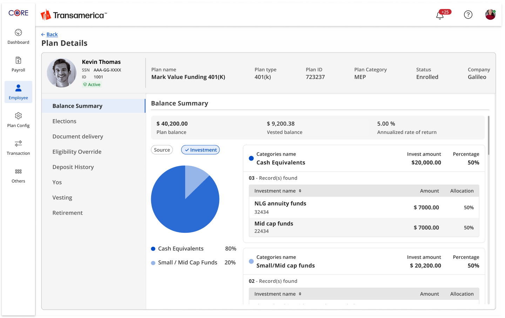
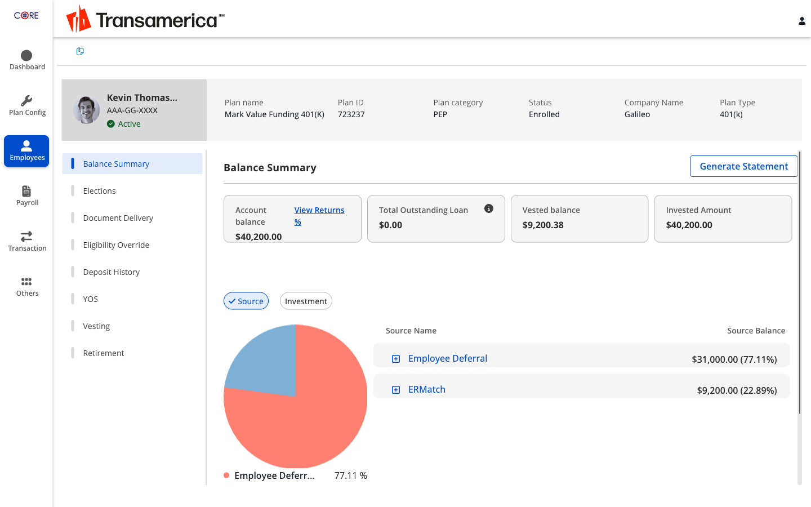
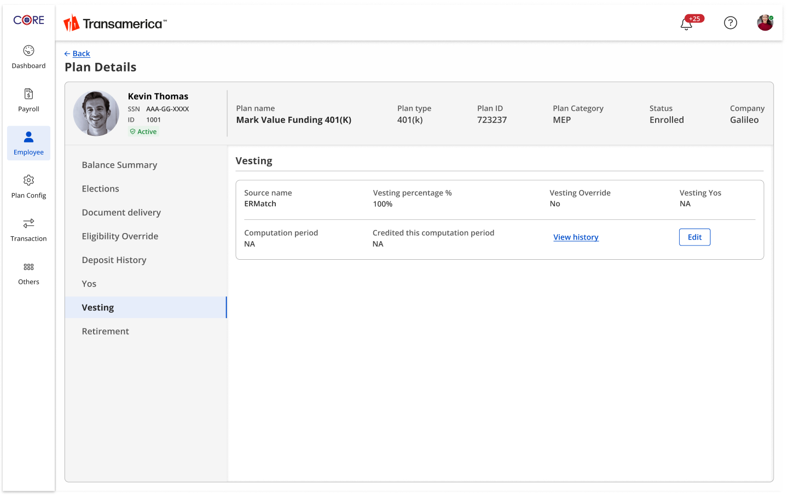
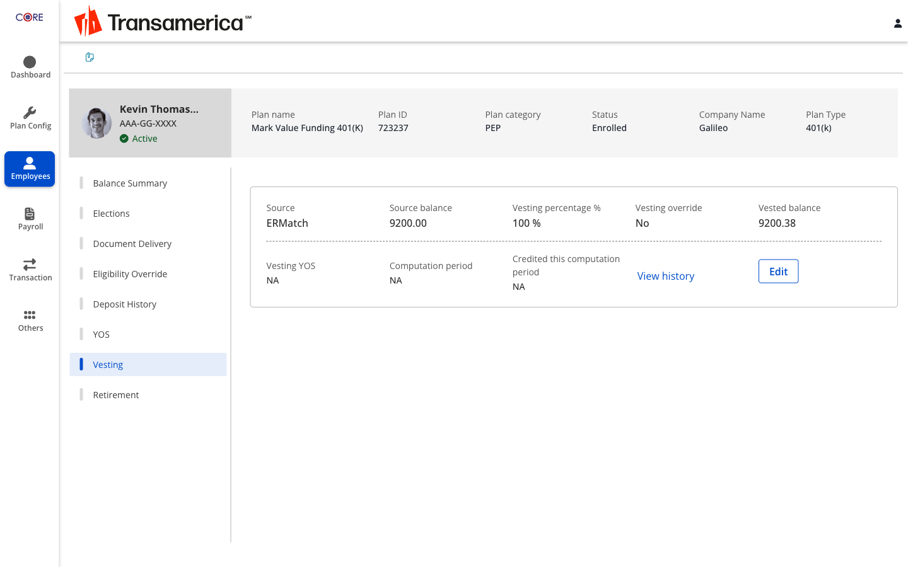
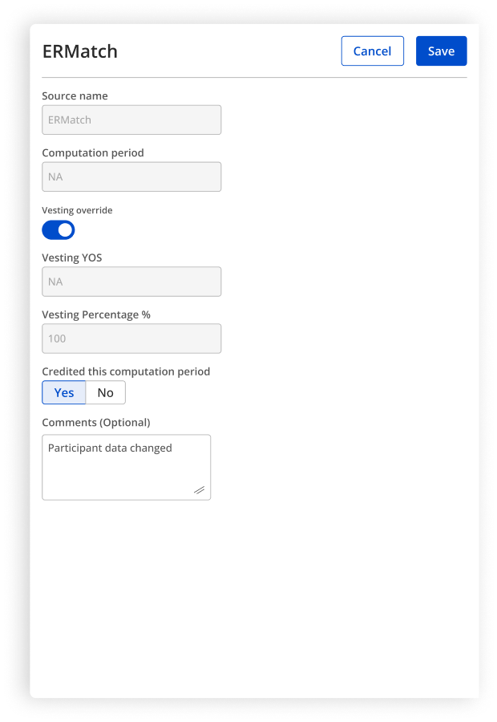
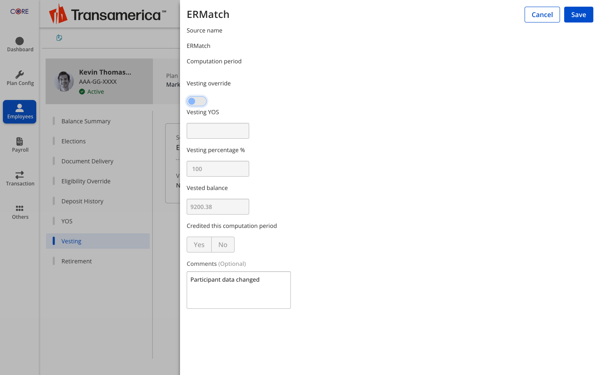

# Figma vs production

The Figma design is on the left and the POC (unchanged production components) on the right.
For a styled version of the same comparison, open [`figma-vs-production.html`](figma-vs-production.html) in a browser.

**Why they differ.** Figma is the new design. The POC loads the ready-made production page
`EmployeeManagePlansModules` exactly as it is, so it shows how production looks today. Every row in
the tables below is a change needed for production to match Figma.

## 1. Balance Summary

| Figma | Production (POC) |
|---|---|
|  |  |

| Area | Figma | Production today |
|---|---|---|
| Page title | "← Back" link and a **Plan Details** heading | Only a small notes icon |
| Summary figures | 3 figures in one strip: Plan balance, Vested balance, Annualized rate of return | 4 boxes: Account balance, Total outstanding loan, Vested balance, Invested amount |
| Extra button | None | "Generate Statement" |
| Profile box | Name, SSN, ID 1001, Active badge | Name (cut off), SSN, Active. No ID |
| Plan details row | Plan type second; category MEP | Plan type last; category PEP |
| Chart | Investment view; category tables on the right | Source view; source list on the right |
| Top bar | Bell with +25, help icon, profile photo | User icon only |
| Left menu icons | Outline icons | Some show a grey circle (Pro icon not licensed) |

## 2. Vesting

| Figma | Production (POC) |
|---|---|
|  |  |

| Area | Figma | Production today |
|---|---|---|
| Vesting card | Source, Vesting %, Override, YOS, period fields, View history, Edit | Same fields and buttons (`CensusVestingCard`) |
| Page title and top bar | Back, Plan Details, bell, help, avatar | Same gaps as Balance Summary |

## 3. Edit slide-over

| Figma | Production (POC) |
|---|---|
|  |  |

| Area | Figma | Production today |
|---|---|---|
| Panel width | 600px | About 70–80% of the screen (`SliderPanel` default) |
| Fields | Source, Computation period, Override, YOS, Vesting %, Credited Yes/No, Comments | Same order, plus Vested balance |
| Labels | Figma kit input style | Labels above inputs |

## Library components that could close the gap

The source zip has about 433 components. These exist and could build each Figma section without edits.

| Figma section | Candidate components | Used in POC today? |
|---|---|---|
| Investment tables | `KendoTable`, `DataTable`, `CsplTable`, `CsplTableWithSort`, `ScrollTable` | No |
| Top bar (bell, help, photo) | `HeaderNew`, `HeaderProfileDropdown`, `NotificationPopUp`, `Avatar` | No (uses `Header`) |
| Active badge, chips | `BadgeComponent`, `ChipButtonGroup` | Partly |
| Profile box | `EmployeeDetailsCard`, `EmployeeDetailsWithPlan`, `ProfileImage` | Production version |
| Vesting card | `CensusVestingCard` | Yes |
| Edit slide-over | `SliderPanel` | Yes (default width) |

## Blockers

1. **Duplicate components.** 5+ tables and 3+ headers, each slightly different. An approved one must be chosen.
2. **Missing pieces.** No dedicated "← Back + page title" component or 3-figure summary strip. These need small new layout code.
3. **Paid icons.** Font Awesome Pro needs the company licence; 29 icons fall back to a circle.
4. **Built-in styling.** Fixed slide-over width and logo height need overrides if there's no setting.
5. **Data differences.** Figma shows rate of return and category MEP; production fetches different fields.

## What's needed

| Item | Owner | Why |
|---|---|---|
| Approval to build a Figma-shaped page from library components | Product / design | Keeps "no component edits" while matching layout |
| Choose the approved table, header and badge components | Design system team | Removes duplicates |
| Font Awesome Pro licence token (`.npmrc`) | Engineering | Real icons |
| Confirm API returns rate of return and plan category | Backend | Figma shows fields production doesn't fetch |

**Suggested first step:** rebuild Balance Summary with one library table and a new header layout, labelling each piece "from library" or "new layout".
